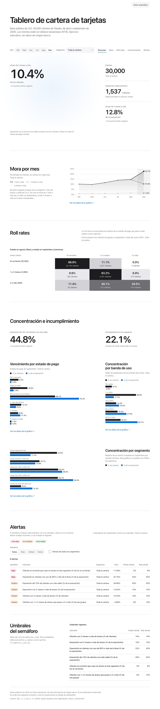
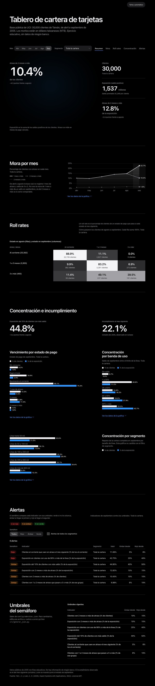
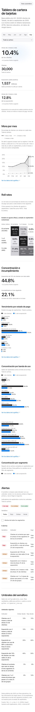

# Tablero de cartera de tarjetas

Tablero estático que lee un JSON agregado de una cartera de tarjetas y muestra mora, roll rates, concentración y alertas con semáforo. Corre en el navegador sin dependencias externas.

Es un ejercicio educativo con datos públicos de 2005. No usa información de ningún banco.



## Los datos

Uso la base "Default of Credit Card Clients" de UCI (Yeh y Lien, 2009): 30,000 clientes de tarjeta de Taiwán, de abril a septiembre de 2005. Es la misma del proyecto riesgo-credito-politicas. Los montos están en dólares de Taiwán.

## Qué muestra

La página abre con tres indicadores principales: clientes, exposición y atraso de 2 meses o más. Los filtros de mes, segmento, semáforo y alcance de las alertas permiten acotar la vista. Con septiembre y toda la cartera, que es la vista inicial, el tablero da estos números, todos calculados por `src/generar_json.py`:

- 1,537 millones de exposición (saldos positivos) en 30,000 clientes.
- 10.4% de los clientes con 2 meses o más de atraso, que equivale al 12.8% de la exposición.
- El 10% de clientes con más saldo concentra el 44.8% de la exposición.
- El 22.1% incumplió el mes siguiente, según la propia base.

Las secciones son:

1. Mora por mes: líneas de 1, 2 y 3 meses de atraso o más.
2. Roll rates: matriz de un mes contra el anterior, en tres grupos de estado.
3. Vencimiento por estado de pago: seis estados, de "sin consumo" a "3 meses o más" (3 y 4 meses o más van agrupados), con el porcentaje de clientes y de exposición.
4. Concentración por banda de uso y por segmento de línea.
5. Alertas: seis indicadores por mes y segmento contra umbrales de ámbar y rojo.

Cada gráfica tiene su tabla de datos en un bloque desplegable, útil para lectores de pantalla.

De abril a agosto la base casi no registra "1 mes de atraso", así que la mora de 1 mes o más salta en septiembre sin que el comportamiento haya cambiado tanto. Por eso los indicadores usan 2 meses o más, para que la serie sea comparable.

## Umbrales de las alertas

Están en `config/umbrales.json`, con un valor de ámbar y uno de rojo por indicador. Son ejemplos para ilustrar el semáforo y no corresponden a la política de ninguna institución. Para cambiarlos, edita el archivo y vuelve a generar el JSON:

```bash
python src/generar_json.py
```

Un valor igual o mayor al de rojo es rojo, y uno igual o mayor al de ámbar es ámbar; en todos los indicadores un valor más alto es peor. Con los umbrales actuales, las 204 combinaciones de mes, segmento e indicador dan 45 en rojo, 68 en ámbar y 91 en verde.

## Cómo correrlo

```bash
python -m venv .venv
source .venv/bin/activate
pip install -r requirements.txt
python src/preparar_datos.py      # descarga y verifica la base (una vez)
python src/generar_json.py        # crea web/datos/cartera.json
python -m pytest
python -m http.server 8000 --bind 127.0.0.1 --directory web
```

Después abre http://127.0.0.1:8000. La página necesita un servidor porque lee el JSON con fetch; abrir el archivo directo desde el disco no funciona.

Si ya tienes la base de riesgo-credito-politicas en la carpeta vecina, `generar_json.py` la usa sin descargar nada.

## Pruebas

Las pruebas recalculan desde el CSV, con la biblioteca estándar de Python, los totales de clientes y exposición por mes, los porcentajes de mora, la concentración del 10% con más saldo, los estados de pago, las bandas de uso y las matrices de transición, y los comparan con el JSON. También revisan que los segmentos sumen el total, que cada semáforo corresponda a su umbral y que el HTML mantenga la política CSP y no use innerHTML, eval ni recursos externos. Si falta la base, se omiten las pruebas de cuadre y corren las demás.

## Seguridad y accesibilidad

La política CSP del HTML permite solo recursos del mismo origen. Las gráficas son SVG armados con el DOM y los textos entran con textContent. Los colores cumplen contraste AA en tema claro y oscuro (sigue el del sistema y hay un botón para cambiarlo), los controles se usan con teclado y tienen foco visible, y el semáforo lleva texto además de color. Revisé la página en un ancho de 375 px.



En 375 px de ancho: 

## Límites

- Es una cartera de Taiwán en 2005, con seis meses de historia.
- No hay fecha de originación, producto ni región. Los segmentos son rangos del límite de crédito.
- Los umbrales son de ejemplo.

## Referencia

Yeh, I. C. y Lien, C. H. (2009). The comparisons of data mining techniques for the predictive accuracy of probability of default of credit card clients. Expert Systems with Applications, 36(2).

Licencia MIT.
